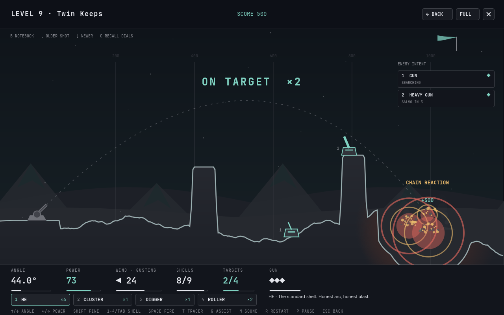

# Omartillery

Set the angle. Set the power. Walk them on.



A retro 2D artillery game for the Omarchy bar. One gun, a finite rack of shells
and a line of emplacements across broken country — that shoot back. Ten campaign
levels, four-battle operations with branching routes, and a daily challenge on a
shared battlefield. Every crater is permanent, terrain collapses, and the wind
is a real air mass, not a number added to your aim.

## Install

```sh
omarchy plugin add https://github.com/badgetobytes/omartillery.git --enable
```

A ◥ appears in the centre of the bar. Update with
`omarchy plugin update fstander.omartillery` (close the game first) and remove
with `omarchy plugin remove fstander.omartillery`. No install hooks and no
network access; the plugin never starts a process, opens a file, or asks for a
password. Requires Omarchy 4 (Quattro); nothing is built at install time.

## Play

Click the ◥, or run `omarchy-shell shell toggle fstander.omartillery '{}'`.

Start the **Campaign** at level one and work up from plain ranging to mixed
enemy batteries in a gale. Then take a **Field Operation** — four battles on a
branching route, carrying your health and ammunition between them — or fire
**The Daily Battery**, one seeded fight per day that everyone gets the same.

Pick a shell, read the wind, fire, and correct from where the last one landed.
The notebook keeps your last three shots so you can walk them in. From level
four the emplacements range you back, a little closer every turn, so the gun
that is shooting at you is usually the one to kill first.

## Controls

| Key | Action |
| --- | --- |
| ↑ ↓ / W S | Elevate and depress |
| ← → / A D | Power |
| Hold Shift | Fine adjustment |
| 1–4, Tab or Q | Pick a shell, or cycle the rack |
| Space / Enter | Fire |
| B | Show or hide the gunner's notebook |
| [ and ] | Step back and forward through your last three shots |
| C | Recall the selected shot's dials |
| T | Tracer — draw the selected shot's path |
| G | Aim assist — preview the arc, ignoring wind |
| R / P / M | Restart, pause, sound |
| F or F11, or FULL | Fullscreen |
| Escape | Back |

Menus work entirely from the keyboard: arrows move, Enter activates, Escape
goes back. The dials move at a fixed rate per second, so aiming feels the same
whatever your key repeat settings are. Mouse aiming — pointer, wheel for power,
click to fire — is off by default; turn it on under **Settings › Mouse control**.

## Themes

Every colour is derived from the active Omarchy palette at runtime, each ink
nudged toward black or white until it clears a contrast target on the surface
it is drawn on, so the game stays legible on dark, light and monochrome themes
alike. A theme switch repaints a paused level immediately. It installs no theme
files.

## Your records

Settings, stars, medals and scores are kept as a `records` object on the
widget's own entry in `~/.config/omarchy/shell.json`, written by the shell
through its plugin settings API. Keep the widget in the bar to keep your
records; removing the plugin removes them. Everything read back out is clamped
into range before the game touches it, so a hand-edited file cannot break it.
Nothing is sent anywhere.

## Read more

- [Field manual](docs/field-manual.md): drag and wind shear, the four shell
  types, terrain collapse, the enemy roles, the three modes and scoring.
- [Development](docs/development.md): running the checks, installing from a
  checkout, live inspection over shell IPC and the rendering budget.

## License and credits

MIT, see [LICENSE](LICENSE). Every sound is synthesized from noise and
oscillators by `scripts/generate-sounds.py`; no sampled material is shipped.
Tested on Omarchy 4.0.3.
